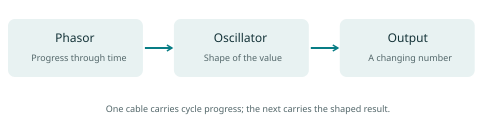
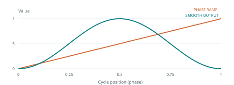
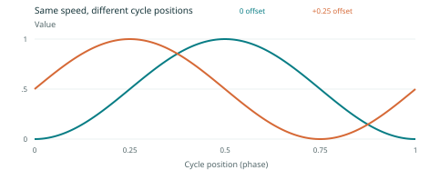
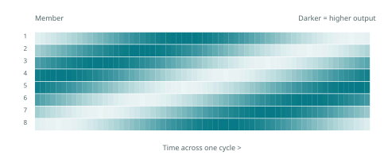
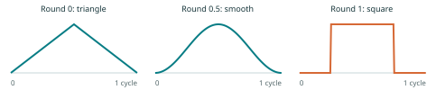
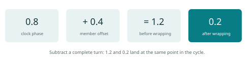

# Oceanode
## A beginner's guide to making patterns with numbers

Edition 1 - October 2026

For artists, musicians, designers and anyone who wants to build moving patterns.
No programming or advanced mathematics is needed.

This guide follows the core Oceanode interface and the node addons available in this workspace. Your Oceanode application may include a different selection of addons. A node mentioned here appears in Help only if your application has registered it. The drawings explain ideas; they are not screenshots.

## How to use this guide

Read chapters 1-5 and build the first patch before studying the theory. Chapters 6-12 explain the ideas that make Oceanode useful: cycles, phase, lists of values, indexing, oscillator banks and waveshaping. Chapters 13-19 turn those ideas into practical ways of working. Chapter 20 is a troubleshooting guide, followed by a glossary and a reference sheet.

Every exercise has a small goal and something to look for. Change one control at a time. Watch what happens, then try to explain it in your own words. Understanding a small patch is more useful than collecting a large patch you cannot follow.

You can skip every formula and still follow the exercises. The formulas are there for readers who want a more exact explanation after seeing the result.

# 1. What Oceanode does

Oceanode lets you build a system by connecting small tools called **nodes**. A node might produce a repeating number, reshape a pattern, choose a note, read a file or send values to another application.

A collection of connected nodes is called a **patch**. You build it on a workspace called the **canvas**. A connection carries a value from one node to another. When an upstream value changes, it can cause the nodes receiving it to produce new results.

Think of a patch as a set of relationships. Instead of drawing every frame of a moving light, you might say: "Repeat this rise and fall, spread it across 16 lights, then make the bright part narrower." Oceanode keeps calculating those relationships as the pattern runs.

The same pattern can serve different purposes. A value that rises from 0 to 1 could control brightness, position, a video effect or a sound parameter. Which result you get depends on what receives the value.

**A useful distinction:** a changing number is not yet a picture or a sound. A numerical Oscillator can run perfectly while nothing is visible or audible. You need a suitable display or output node to turn its values into a result.

Oceanode applications often include extra node collections called **addons**. These may provide video, lights, MIDI, OSC, drawing or SuperCollider sound tools. Start with the core number-generating tools. Add a destination once you understand the pattern.

> First question to ask: What is making the values, what is changing them, and what is receiving them?

# 2. Finding your way around

The **canvas** holds your patch. Drag a node to arrange it. Drag an empty part of the canvas to move your view. Use the application's zoom controls or canvas zoom gesture to move between an overview and detailed editing.

The **Nodes** window helps you find nodes already present in the patch. The **Inspector** shows settings for the selected node. Some settings live in the Inspector rather than directly on the node.

Drag a window title or tab to rearrange it. Drop it into a docking area to attach it to the workspace. Docked windows can share a tab group; click a tab to bring that window forward.

The **Window** menu lists controllers, node windows, macro canvases and custom panels. If you close an editor, reopen it here. Entries include the node instance or its canvas path, which helps when several similar nodes exist.

The **Help** menu contains a searchable node reference and an AI assistant. Search accepts several keywords and looks through names, categories, descriptions and parameter names. All the keywords must match somewhere in an entry. Try "smooth random" or "vector select". If there are no results, use fewer words.

Right-click an empty part of the canvas to open the node-creation popup. Find the node you want and select it. The exact node collection depends on your application.

A node has named **parameters**: controls such as Size, Phase, Index or Output. Small connection points beside parameters are called **pins**. Drag from an output pin to a compatible input pin to connect them. Many editable parameters can also send their values onward; an Output parameter is usually intended to send.

To remove a connection in the current canvas, drag from its connected input pin into empty space and release. Dragging from that input to another compatible input can move the connection.

Look at the names at both ends of a connection. A cable between the wrong parameters can look tidy while producing the wrong result.

> When lost, return to Window > Canvas, select one node, and inspect its incoming connections.

# 3. Numbers, lists and events

Most beginner patches use a few simple kinds of data.

| Kind | Example | What it means |
| --- | --- | --- |
| Decimal number | 0.35 | A continuously adjustable amount |
| Whole number | 8 | A count, size or selected item |
| On/off value | true or false | A state that stays on or off |
| Trigger | One event | Do something now |
| Text | My pattern | A name, message or file-related value |
| Vector | [0.1, 0.6, 0.9] | An ordered list of values |

**Vector** is Oceanode's word for a list. In this guide it usually means a list of numbers, not a geometric arrow. The first item might describe the first light or voice, the second item the second light or voice, and so on.

A **gate** is an on/off state that can stay high. A **trigger** is an event. Holding a gate open for a second and sending a single trigger are different instructions. Some nodes represent triggers as short numerical pulses; others use a trigger-only connection. Check the receiving parameter's description.

Many creative controls use the range **0 to 1**. This is called a normalized range. For brightness, 0 could mean dark and 1 fully bright. For position, 0 could mean one edge and 1 the other. The number has no physical meaning until a destination gives it one.

Not every parameter uses this range. Pitch may be a note number; duration may use milliseconds; position may use pixels. Always check the destination's range and units.

Oceanode supports some conversions between data types. It does not support every possible connection. If a connection is refused, check the data type and pin direction instead of repeatedly trying the same cable.

# 4. Your first moving patch

**Goal:** make one value rise and fall repeatedly. You need only the core Phasor and Oscillator nodes.

1. Right-click empty canvas space and add **Phasor**.
2. Add **Oscillator** nearby.
3. Connect Phasor's **Phase** output to Oscillator's **Phase** input.
4. Set the shared transport tempo to **60 BPM**. On Phasor, also set **BPM = 60**, **Div = 1**, **Mult = 1** and keep **Loop** on.
5. On Oscillator, keep **Round = 0.5**, **PulseW = 0.5**, **Skew = 0**, **Index = 0** and **Ph Off = 0**.
6. Observe Phasor's Phase and Oscillator's Output using their value or scope display. If your application exposes a scope option in the parameter menu, use it.

Phasor should repeatedly climb from 0 toward 1, then return to 0. Oscillator should turn that progress into a smooth rise and fall: near 0, up to 1, then back toward 0. At these settings, a full cycle takes one second.

If the patch is stationary, start the transport. Check whether **Sync To Transport** is enabled in Phasor's Inspector. A transport-synced Phasor follows the shared transport; a free-running one has its own timing behavior. Confirm Loop is on and try Reset.

Now change Div from 1 to 4. The cycle should take four seconds. Return Div to 1 and set Mult to 2. It should take half a second. Restore the original settings before continuing.

If you have a suitable output node, connect Oscillator's Output to one normalized brightness or opacity control. Keep the scope visible so you can compare the numerical pattern with the visible result.

> What to notice: Phasor provides progress through a cycle. Oscillator decides the shape of the value during that cycle.

# 5. Editing and saving a patch

Arrange a patch so you can read it from its sources toward its destinations. For example: clock on the left, pattern-making nodes in the middle, outputs on the right. Leave space for labels and future changes.

Select nodes before moving, copying or deleting a group. Shift helps with multiple selection. In the current desktop interface, Command-drag on macOS or Control-drag on Windows/Linux creates a selection region. Click empty space to clear the selection.

| Action | macOS | Windows / Linux |
| --- | --- | --- |
| Copy selected nodes | Command+C | Control+C |
| Cut selected nodes | Command+X | Control+X |
| Paste near the pointer | Command+V | Control+V |
| Duplicate near the pointer | Command+D | Control+D |
| Select all in the canvas | Command+A | Control+A |
| Delete selected nodes | Backspace | Backspace |

Copying connected nodes together is a useful way to preserve a small structure. Holding Shift when pasting or duplicating can also bring incoming connections from outside the copied group. Use that only when you want the new structure to share those sources.

**Edit > Auto Layout Selection** and **Auto Layout Canvas** can help arrange a crowded patch. Inspect the result and make the reading order clear.

A **preset** stores a patch state for later recall. Use **Presets > Save Preset As...** for a new named version, then **Save Preset** to update it. A **bank** groups presets. Save a working copy before making a large experiment.

A saved GUI layout and a saved preset serve different purposes. A layout arranges windows. A preset stores patch content and values. Some special parameters are intentionally excluded from preset saving, and external resources may need their own saving or embedding options.

# 6. Cycles, tempo and speed

A cycle is one complete repeat. A lamp growing bright, becoming dim and returning to its starting condition has completed a cycle. An oscillator repeats a pattern of values over cycles.

**Frequency** means cycles per second. Its unit is **hertz**, written Hz. At 1 Hz, there is one cycle each second. At 0.5 Hz, a cycle takes two seconds. At 2 Hz, there are two cycles each second.

**Period** means the time needed for one cycle. A longer period means slower movement.

Oceanode's Phasor uses BPM, Div and Mult to describe its speed. BPM means beats per minute. With Div and Mult both at 1, each beat is one cycle. Div makes the cycle longer. Mult makes it shorter.

| BPM | Div | Mult | Time for one cycle |
| --- | --- | --- | --- |
| 60 | 1 | 1 | 1 second |
| 60 | 4 | 1 | 4 seconds |
| 60 | 1 | 2 | 0.5 seconds |
| 120 | 1 | 1 | 0.5 seconds |
| 120 | 4 | 1 | 2 seconds |

A cycle every four beats is not automatically one bar. It is one bar in a four-beat meter, such as 4/4. Other meters have different bar lengths.

Optional formulas:

`frequency = (BPM / 60) x (Mult / Div)`

`seconds per cycle = (60 / BPM) x (Div / Mult)`

Try predicting the period before changing a control. At 120 BPM, Div = 8 and Mult = 1 gives a four-second cycle. Count it while watching the output.

> Tempo controls how quickly a pattern unfolds. It does not decide whether that pattern is smooth, sharp, symmetrical or irregular.

# 7. Phase: where you are in a cycle

**Phase** is your position within a repeating cycle. Oceanode commonly expresses it as a number from 0 to 1.

Imagine walking around a circle. Phase 0 is the starting point. Phase 0.25 is a quarter of the way around, 0.5 halfway, and 0.75 three quarters. Phase 1 completes the circle and meets the starting point again.

| Phase | Fraction of a turn | Angle |
| --- | --- | --- |
| 0 | Start | 0 degrees |
| 0.25 | One quarter | 90 degrees |
| 0.5 | One half | 180 degrees |
| 0.75 | Three quarters | 270 degrees |
| 1 | One full turn | 360 degrees |

Phasor makes this progress visible as a rising ramp. The return from nearly 1 to 0 is intentional: the next cycle is beginning. A phase ramp is different from a smooth brightness fade because the ramp has a sudden return.

An oscillator reads the phase and answers: "At this point in the cycle, what should the output be?" A smooth waveform gives a smoothly changing answer. A square waveform gives only low or high answers.

Phase is not brightness. With the default smooth Oscillator shape, phase 0 gives output 0; phase 0.25 gives 0.5; phase 0.5 gives 1; and phase 0.75 gives 0.5. The second half of the cycle comes back down even though phase is still going up.

> Exercise: pause a transport-synced patch and inspect its Phase and Output. They describe two different things: progress and result.

# 8. Phase difference: together, opposite, following

Two oscillators can run at the same speed while visiting different parts of the cycle. The distance between their cycle positions is their **phase difference**.

For a practical test, connect the same Phasor Phase output to the Phase inputs of two Oscillators. Give both the same shape settings. On the second Oscillator, change **Ph Off** to 0.25. It now reads a position one quarter of a cycle ahead. Set Ph Off to 0.5 and compare again.

With matching smooth default shapes, a half-cycle difference makes one output high when the other is low. A full-cycle difference returns to the same relationship as no difference. This is because phase wraps around the circle.

Oceanode adds the offset before reading the shape. A positive phase offset reads further ahead in that shape. The apparent direction of movement across a row also depends on which physical item receives each value. Reverse the item order and the apparent direction reverses.

A phase difference is a fraction of a cycle, not a fixed number of seconds. At a four-second period, 0.25 of a cycle is one second. At a one-second period, the same phase difference is a quarter-second.

Do not confuse **offsetting phase** with **delaying a signal**. A phase offset asks the waveform for a different cycle position. A delay uses an earlier value from the signal's history. These can look alike for a steady repeating wave, but behave differently when speed or shape changes.

> Try 0, 0.25 and 0.5 on the second Oscillator. Describe each relationship before trying more complicated settings.

# 9. One value becomes a bank

An **oscillator bank** is a group of oscillators handled together. Each member can share some settings and have its own value for others.

You could build 16 separate Oscillator nodes. Often it is easier to use one Oscillator node with a 16-item list. Its Output then contains 16 values. The members are sometimes called **elements** or **voices**. Voice does not necessarily mean an audible note; it can mean one light, point, column or other controlled item.

The most useful beginner arrangement is:

- One shared Phase makes the whole bank move together in time.
- A list at Index places the members at different positions in that cycle.
- Shared shape controls give the members the same kind of rise and fall.
- The Output list gives each member its own current value.

Many core numerical nodes allow a one-item list to supply the same setting across a larger bank. For example, one Round value can shape all 16 members. A longer Round list can give different members different shapes. Do not assume every addon handles mismatched list sizes in the same way.

Keep related lists the same length while learning. If your destination has 16 lights, begin with 16 indices and expect 16 output values. Check list size whenever a pattern unexpectedly repeats, loses items or changes shape.

A bank with a shared clock and different phases does not need different speeds to create movement. The members rise and fall at different moments because they occupy different places in the same cycle.

> Think of a bank as many dancers following one musical phrase, each starting at a different point in it.

# 10. Indexing: giving each member a place

An **index** identifies an item's place in a list. In Oceanode's pattern tools, a list of indices can also describe positions distributed across a cycle or shape.

A simple four-member cyclic bank could use the phase positions:

`[0, 0.25, 0.5, 0.75]`

These are four evenly spaced places around a circle. All four positions share one clock. Their spacing stays the same while the clock moves.

The core **Indexer** creates distributions for you. **Size** chooses how many values it produces. **NWaves** controls how much wave repetition fits across the distribution. **Invert**, **Sym**, **Shuffle**, **Random**, **Offset** and **Quant** change its arrangement.

Indexer offers more than one spacing convention. With its default centered, non-Norm distribution, four members at one wave are approximately:

`[0.125, 0.375, 0.625, 0.875]`

Each value sits in the middle of one of four equal sections. Turn **Norm** on and an uncomplicated four-item, one-wave distribution includes both endpoints:

`[0, 0.333..., 0.666..., 1]`

Both conventions are useful. For a line with two ends, including 0 and 1 can be convenient. For a repeating cycle, 0 and 1 describe the same phase, so the first and last members can match. This is an endpoint choice, not an extra oscillator.

Start with **Size = 8**, **NWaves = 1**, **Norm off**, and leave other Indexer controls at their defaults. In the Inspector, leave **Discrete off** for this exercise. Discrete indices are useful for addressing items; continuous phase positions are what we want here.

# 11. Build your first travelling wave

**Goal:** make eight values rise and fall at different moments using only three core nodes.

1. Keep the Phasor-to-Oscillator connection from chapter 4.
2. Add **Indexer**. Set Size to 8, NWaves to 1, Norm off and Discrete off.
3. Connect Indexer's **Output** to Oscillator's **Index**.
4. Set Phasor to BPM 60, Div 4 and Mult 1 for a slow cycle.
5. Observe Oscillator's Output as a list or through a suitable vector display.

The Oscillator output should now contain eight values. Each has the same repeating shape, but a different cycle position. If a destination draws the values as eight bars or assigns them to eight lights in order, you should see a pattern moving across the group.

Try these experiments separately:

- Change **Size** to 16. There should be more members in the bank.
- Change **NWaves** from 1 to 2. More repetition should fit across the group without changing the Phasor's cycle time.
- Move **Invert** from 0 to 1 on Indexer. Compare the ordering at those two endpoints.
- Increase **Sym** by one. Look for mirrored or folded spatial structure.
- Return Sym to 0, then try Shuffle or Random. The timing source remains shared while the orderly relationship between members becomes less regular.

Indexer does not have to keep changing to make an animated pattern. It can provide a fixed distribution while Phasor supplies the movement through time.

> Remember two separate questions: How fast does the pattern move in time? How is it arranged across the members?

# 12. Waveshaping: changing the character of motion

**Waveshaping** means changing the relationship between phase and output. The cycle can keep the same length while its shape changes.

On the core Oscillator, start with Round 0.5, PulseW 0.5, Skew 0, Scale 1, Offset 0, Pow 0, BiPow 0, Quant 0, Fader 1 and Invert 0. These settings give a smooth rise and fall without the extra shaping stages.

| Control | What to explore |
| --- | --- |
| Round | 0 gives a triangle-like rise and fall; 0.5 gives a smooth cosine-based shape; 1 gives a square-like low/high shape. |
| PulseW | Changes how much of the cycle is occupied by parts of the shape. Try small moves around 0.5. |
| Skew | Changes the balance between rising and falling time. |
| Ph Off | Moves the whole shape around the cycle. |
| Scale / Offset | Multiply the value and move its level; intermediate results are limited to the 0-1 range. |
| Pow / BiPow | Bend the response curve. Zero is neutral. These controls use Oceanode's own shaping curves. |
| Quant | Restricts values to steps. 0 disables it; try 2 or 4. In this core node, 1 produces a flat zero before later stages. |
| Fader | Scales the value near the end of the shaping process. |
| Invert | At 1, turns high values into low values and low into high. |

Make a smooth breath with Round 0.5. Make a sharper rise and slower fall by exploring Skew. Make stepped motion with Quant 4. Restore each control before testing the next one.

The order of operations matters. In the core Oscillator, inversion happens after Fader, so Fader at zero does not guarantee a zero output when Invert is active. Watch the final Output rather than assuming a control's name tells the whole story.

# 13. The small amount of math underneath

Here is a compact description of the bank you have built. It explains the idea without reproducing every detail of the Indexer or Oscillator controls.

For each member:

`local phase = wrap(clock phase + member index + phase offset)`

`output = chosen shape(local phase)`

**Wrap** means keep going around the circle. A value of 1.2 becomes 0.2: one complete turn plus one fifth of another turn. It does not mean clamp. Clamping 1.2 to a 0-1 range would hold it at 1 instead.

For the default smooth shape, before later shaping controls, the mathematical curve is:

`output = (1 - cos(2 x pi x local phase)) / 2`

You do not need to calculate cosine by hand. The formula simply describes a smooth journey from 0 to 1 and back to 0. The factor 2 x pi translates one normalized cycle into the angle used by the cosine function.

A simple cyclic distribution can use:

`member index = member number / number of members`

Count member numbers from zero. With four members, this gives 0, 0.25, 0.5 and 0.75. This is a teaching example; the Indexer's centered and Norm options use the spacing described in chapter 10.

There is an important creative idea in these formulas: **time, distribution and shape can be designed separately**. Change the clock to alter speed. Change the index list to alter relationships between members. Change the shape to alter each member's behavior. Then combine them.

# 14. Mapping a pattern to a useful range

A normalized value is convenient for making a pattern, but your destination may need a different range. **Mapping** changes one range of numbers into another.

For example, a smooth Output from 0 to 1 can become a control moving between 0.2 and 0.8. The shape and timing stay the same; the range becomes smaller and moves upward.

With the core **Mapper**:

1. Connect Oscillator's Output to Mapper's **Input**.
2. Set **Min In = 0** and **Max In = 1**.
3. Set **Min Out = 0.2** and **Max Out = 0.8**.
4. Observe Mapper's Output before connecting a destination.

A midpoint input of 0.5 becomes 0.5 in this example. Input 0 becomes 0.2; input 1 becomes 0.8. The core Mapper clamps values to the selected mapping endpoints instead of allowing unlimited overshoot.

For ranges outside 0-1, use a tool designed for those values, such as **Ranger**, and check its parameter ranges. A position of 500 pixels or a MIDI controller range of 0-127 needs a different scale from normalized opacity.

A simple range conversion, away from a zero-width input range, is:

`output = low + input x (high - low)`

This version assumes the input is already between 0 and 1.

A value can also be a **modulator**: a changing number controlling a parameter of another node. For example, a slow Oscillator can change another Oscillator's Skew. Start with a small mapped range so the result remains understandable.

# 15. Smoothness, randomness and rhythm

A repeating oscillator is predictable. Random tools introduce variation. Different kinds of randomness create different feelings.

**Random Generator** produces discrete changes driven by its phase input. It is useful when you want a new choice at particular moments. A random oscillator produces smoothly changing random values. **Noise** provides a noise-based relationship to its input. Look up each node before choosing one; random does not always mean a new unrelated value every frame.

A **seed** is a starting choice for a random process. Where supported, the same seed and the same sequence of events can help reproduce a pattern. Some nodes also offer transport synchronization. Reproducibility depends on the node and timing mode, so check it before relying on it for a performance.

**Smoother** softens changes. A sudden jump may become a gradual move. Smoothing also introduces a lag: the result takes time to catch up. Use it for gentler motion, not when you need a precise trigger to arrive immediately.

Rhythms often use pulses rather than smooth curves. A square-like Oscillator can provide a high/low pattern, but a high state is not automatically a one-time trigger. Use the appropriate change, threshold or trigger tool if the destination needs an event only when the value crosses a boundary.

**Exercise:** make a slow, smooth oscillator bank first. Change its shape toward a square, then add a little randomness to its arrangement. Listen or look for which change alters regularity, which alters shape, and which alters speed.

> Keep one clear source of timing while learning. Several unrelated clocks can make a simple patch surprisingly hard to understand.

# 16. Transport and timeline

The **transport** is the shared sense of playback: play state, tempo and position. The **timeline** arranges changes along that playback position.

A useful way to separate their roles is: the transport says where playback is; a timeline clip says what should happen there; an oscillator says how a repeating pattern behaves.

Open **Window > Timeline**. The timeline offers playback, tempo, looping, zoom and follow controls. A loop repeats a selected time range. Zoom changes how much time you see; it does not change the speed of the patch.

To try parameter automation:

1. Choose a visible numerical parameter with a suitable range.
2. Open its context menu and choose **Add to Timeline Track**.
3. Create a new track or select an existing one.
4. In the Timeline, create a clip from the track's context menu.
5. Use a suitable curve or step lane to draw a change, then play through the clip.

A **curve** describes a continuous change. A **step** holds values before changing to another value. Other clip types serve gates, notes or different uses. Start with one parameter, one track and one clip.

If a parameter is also receiving a cable or being changed by another tool, several sources may compete. Give a beginner patch one clear source for each controlled parameter. Temporarily disconnect modulation while learning timeline automation.

For musical synchronization, inspect **Sync To Transport** on timing nodes that offer it. Test play, pause, reset and a jump to a different position. Decide whether the pattern should follow those actions or continue independently.

A wave track can work with audio when the appropriate addon and playback provider are present. Numerical animation alone does not require an audio setup.

# 17. Macros, routers and portals

As a patch grows, place a related group inside a **Macro**. A macro is a node with its own canvas inside. It lets you think about a larger structure as one useful part: an eight-light chase, a voice, a texture treatment or a control panel.

Build and understand the small group first. Then use the available encapsulation tools or move your work into a macro. Open the macro canvas through its node controls or the Window menu. In a macro canvas, Command+Up Arrow on macOS or Control+Up Arrow on Windows/Linux returns toward the parent canvas.

A **Router** exposes a value between a macro and its parent. Think of it as a clearly labeled connection through the wall of the macro. Use meaningful names such as Speed, Width or Brightness. The chosen Router type must suit the value it carries.

A **Portal** routes a named value without drawing a long cable through the whole patch. A local portal works within its local scope; a global portal can reach across macro and parent canvases. A Portal Selector chooses a portal and reads its data.

Portals save space, but they hide part of the path a value takes. Use clear names and check scope when two unrelated parts of a project seem to affect each other. A missing cable does not mean a value has no source.

Macros can be local to a patch or saved as reusable resources. Read save prompts carefully when shared macros have changed, because other presets may use them too. A shared macro's own **Save** and **Load** buttons also list its unsaved changes before writing or replacing it. The **Load** and **Save As** dialogs can delete a macro from the library after you confirm. Macro snapshots recall stored states inside a macro; they are different from loading an entire preset.

> A good macro has a clear purpose and a small number of controls that make sense from outside it.

# 18. Making a patch comfortable to perform

A working patch and a comfortable performance interface are different things. The canvas is useful for building relationships. A **Custom GUI** is a panel containing the controls you want to use regularly.

Open a parameter's context menu and choose **Add to Custom GUI**. Create a panel or select an existing one, then choose a suitable control. Depending on the parameter, this might be a slider, knob, toggle, number field or another widget.

Begin with three or four controls. For the oscillator-bank patch, good candidates are the timing division, NWaves, Round and an output-range or brightness control. Give the panel enough space and arrange controls in the order you expect to use them.

Open the panel from **Window > Custom GUIs**. Its controls refer to the underlying patch parameters; they are not separate copies of the patch. A parameter driven by a connection or timeline may immediately override a manual move.

Save the patch and the relevant GUI state, then test reopening it. If you use snapshots, confirm exactly which controls they recall. A snapshot of a published panel is a narrower state than a whole-project preset.

Before a performance, make a small checklist:

- Recall the intended preset and confirm the expected output.
- Check timing, playback state and the selected device or destination.
- Test the controls at both ends of their useful ranges.
- Keep a known working preset you can return to.
- Close construction windows you do not need and reopen the performance panel.

Increase the size and complexity of a patch gradually. More bank members, heavier graphics and additional audio processing all use resources. Stable movement at your intended scale matters more than a large node count.

# 19. From numbers to lights, images and sound

The numerical pattern is reusable. The destination supplies its meaning.

For **lights**, a bank of normalized values might become brightness values for a row of fixtures. Fixture and network nodes may require channel layout, universe, address or destination settings. Check the receiving system's expected range. Begin with a small, low-intensity test.

For **images**, a bank might control positions, sizes, color amounts or texture effects. Numerical vectors, textures and geometric shapes are different data types. Use conversion or drawing nodes when a destination needs a texture rather than a list of numbers.

For **MIDI**, numbers may represent notes, velocities or controller values. A note also needs suitable timing and note-off behavior. Avoid assuming that a smooth 0-1 Oscillator output is already a complete musical note stream.

**OSC** sends messages between applications or devices. The sender and receiver must agree on the address, data, host and port. A changing value inside Oceanode does not prove the receiver is accepting it.

For **SuperCollider sound**, the sound server, audio routing and relevant nodes must be ready. A core Oscillator is a numerical pattern generator; a SuperCollider synthesis node produces or processes audio. A control-rate pattern and an audio waveform can share mathematical ideas while using different processing paths.

When testing any destination, use a simple constant or one slow value first. Once that works, connect your bank. This separates a routing problem from a pattern problem.

Help's AI assistant can explain installed nodes or propose a small patch. It uses the existing Requesty setup. Review the proposed types and connections before choosing **Create in canvas**. The helper uses node defaults, so you may still need to adjust ranges, devices or other controls. It supports simple additions rather than arbitrary edits to an existing project.

# 20. When something does not work

Follow a value from its source to its destination. Stop at the first point where the result differs from what you expected.

| What you see | What to check first |
| --- | --- |
| Nothing changes | Is the clock running? Is Loop on? Is a transport-synced node paused? |
| Phase changes, Output stays flat | Check Phase connection, waveform controls, Quant, Fader and mapping range. |
| Values change but no image or sound appears | Check the output node, device, server, routing and destination. |
| A cable will not connect | Check data type, allowed direction and whether the input already has a connection. |
| A control moves back after you edit it | Look for an incoming cable, timeline automation or another active control source. |
| Only some members respond | Compare list sizes, physical channel count and destination ordering. |
| First and last members match | Check whether your index distribution includes both phase 0 and phase 1. |
| The wave moves the wrong way | Check index order, Indexer Invert and the order at the physical destination. |
| The pattern looks stepped | Check Quant, source update rate, frame rate and destination resolution. |
| A node or editor is missing | Search Help, check which addons are installed, and look in Window. |
| A recalled patch differs | Check preset exclusions, macro save choices, external files and device state. |

To simplify a problem, disconnect the destination and inspect the numerical output. Restore the plain settings from chapter 4. Use one clock, one Oscillator and a small bank. Add the removed parts back one at a time.

If the problem concerns a specific node, read its Help entry. Parameter names and behavior can differ between addons. Use the node's actual pins rather than guessing from a similar name.

Save a separate test preset when investigating. A short patch that clearly shows the problem is also easier to explain when asking for help.

# 21. A practice path

These five studies bring the main ideas together. Use copies of a working preset so you can compare the results.

## Study A: a breathing value

Use Phasor and Oscillator. Set a four-second cycle and a smooth shape. Explain which node makes time and which node makes shape. Then change speed without changing shape.

## Study B: two partners

Use two matching Oscillators with the same Phasor. Compare phase offsets of 0, 0.25 and 0.5. Predict when each output will be high. Change the period and notice that the phase relationship stays the same while its duration in seconds changes.

## Study C: a row of eight

Use Indexer to drive Oscillator Index with Size 8. Try one and two waves. Reverse the ordering. Explain why NWaves changes the arrangement across the group while Div changes time.

## Study D: change the character

Keep the bank's timing and distribution fixed. Try a triangle, a smooth wave and a square. Explore one of Skew, PulseW or Quant at a time. Describe the result with everyday words: breathing, striking, lingering, stepping or flashing.

## Study E: make it usable

Map the output to a limited range. Put useful controls on a Custom GUI. Save a preset, close and reopen the relevant panels, and recall the preset. If an output addon is available, connect the same pattern to one destination and check the expected units.

You have the foundation when you can identify four things in your own patch: **clock, distribution, shape and destination**. More elaborate work grows from combining and modulating those parts.

# 22. Words you will meet

| Word | Plain-language meaning |
| --- | --- |
| Addon | An extra collection of tools included in an Oceanode application. |
| Automation | Parameter changes arranged along a timeline. |
| Bank | A group of presets; in oscillator bank, a group of oscillators. |
| Canvas | The workspace where nodes and connections live. |
| Clip | A section of timeline content. |
| Cycle | One complete repeat of a pattern. |
| Frequency | How many cycles happen each second. |
| Gate | An on/off state that may stay on for a while. |
| Index | An item's place, or a position used to arrange a bank. |
| Mapping | Changing the range of a value. |
| Modulation | Using one value to change a parameter. |
| Normalized | Expressed in a standard range, commonly 0-1. |
| Oscillator | A tool that makes a repeating pattern. |
| Parameter | A named value or control on a node. |
| Period | The time one cycle takes. |
| Phase | Position within a cycle. |
| Phasor | A repeating ramp that tracks cycle progress. |
| Pin | A connection point beside a parameter. |
| Preset | A saved patch state. |
| Quantization | Restricting values or time positions to steps. |
| Transport | Shared playback state, tempo and position. |
| Trigger | A one-time event. |
| Vector | An ordered list of values. |
| Waveshaping | Changing how phase or an input becomes an output. |

# 23. Keep this beside your patch

## The three-node foundation

`Phasor Phase -> Oscillator Phase`

`Indexer Output -> Oscillator Index`

`Oscillator Output -> display, mapping or destination`

Start with Phasor BPM 60, Div 4, Mult 1 and Loop on. Use Indexer Size 8, NWaves 1, Norm off and Discrete off. Use Oscillator Round 0.5, PulseW 0.5, Skew 0, Ph Off 0, Scale 1, Offset 0, Pow 0, BiPow 0, Quant 0, Fader 1 and Invert 0.

## Four questions

1. **Time:** what sets the speed and playback position?
2. **Distribution:** how do the members differ from each other?
3. **Shape:** what does each member do during a cycle?
4. **Destination:** what do the resulting numbers control, and in what range?

## Numbers worth remembering

A quarter cycle is 0.25. A half cycle is 0.5. A full cycle returns to the same phase. At 60 BPM with Div 1 and Mult 1, a cycle takes one second. Increasing Div slows the cycle; increasing Mult speeds it up.

## Good habits

Start small. Inspect the values. Match the ranges. Change one thing at a time. Label the purpose of a group. Save a known working version.

## About this edition

The explanations and named controls were checked against the core Phasor, Indexer, Oscillator, Mapper and canvas/controller implementations in this workspace. Optional output tools depend on the host application's addons and configuration. Exercise outcomes describe the intended numerical behavior; no physical lighting, video or audio setup was operated to produce this guide.

For individual nodes, use Help > Search nodes. The companion node-help-catalog.json lists descriptions, parameter hints and addon/source names. The readable source of this manual is docs/oceanode-user-manual.md. The assistant's separate reference guide is docs/oceanode-assistant.md.
